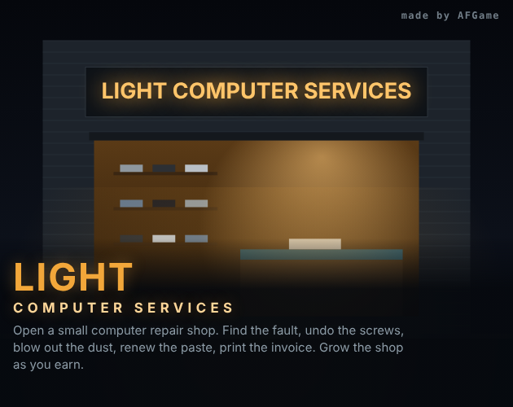

# Light Computer Services

A browser game about running a small laptop repair shop. Diagnose real-world faults, undo the screws, blow out the dust, renew the thermal paste, order parts, print the invoice and grow your shop.

**Play:** https://066040.github.io/Light-Computer-Service-Game/

## Features
- **Real repair work:** power the laptop on and off, plug and unplug the charger, read beep codes, enter the BIOS (F2) and boot menu (F12), run a stress test, check the battery report, Task Manager, Device Manager and antivirus.
- **Hands-on teardown:** remove screws one by one (some hide under a rubber foot), pry the cover, disconnect the battery before touching anything, clean fans, repaste the CPU, swap RAM, drives, batteries, charging ports, keyboards and motherboards.
- **20 hardware and software faults:** overheating, dead fan, dead charger, worn or swollen battery, loose or faulty RAM, dead SSD, dying HDD, flat CMOS cell, broken DC jack, loose Wi-Fi antennas, liquid damage, dead motherboard, malware, Automatic Repair boot loop, missing drivers, startup bloat and RAM upgrades.
- **10 laptop models** with their own colour, size, screw layout, boot animation and boot jingle.
- **Running a business:** order parts (next day or express), sell accessories over the counter, print invoices, ring up the till, keep a ledger, collect reviews and tips, pay daily rent.
- **Upgrades:** air duster, diagnostic USB, soldering station, cordless screwdriver, cloning dock, display case, neon sign, coffee machine, waiting corner, pro bench and more.
- **Guided tutorial** with your old master, Rıza, and a short lesson after every repair.
- Turkish and English, desktop and mobile, auto-save in the browser.

## Run locally
It is a single HTML file with no build step: download `index.html` and open it in a browser.

---

## Türkçe

Küçük bir laptop tamir dükkanı işlettiğin bir tarayıcı oyunu. Gerçek arızaları teşhis et, vidaları sök, tozu al, termal macunu yenile, parça sipariş et, faturayı kes ve dükkanını büyüt.

- Bilgisayarı açıp kapat, adaptörü tak çıkar, bip kodlarını dinle, BIOS ve önyükleme menüsüne gir, stres testi yap.
- Vidaları tek tek sök (bazıları lastik ayağın altında), kapağı aç, önce bataryayı ayır; fan temizliği, macun değişimi, RAM, disk, batarya, şarj girişi, klavye ve anakart değişimi yap.
- Donanım ve yazılım dahil 20 arıza, 10 laptop modeli.
- Parça siparişi, perakende satış, fatura, kasa defteri, müşteri yorumları ve dükkan yükseltmeleri.
- Rıza Usta ile eğitim ve her tamirden sonra kısa bir usta notu.
- Türkçe ve İngilizce, masaüstü ve mobil, otomatik kayıt.

## Credits
Made by **AFGame** — Ahmet Furkan Göktaş ([@066040](https://github.com/066040))
